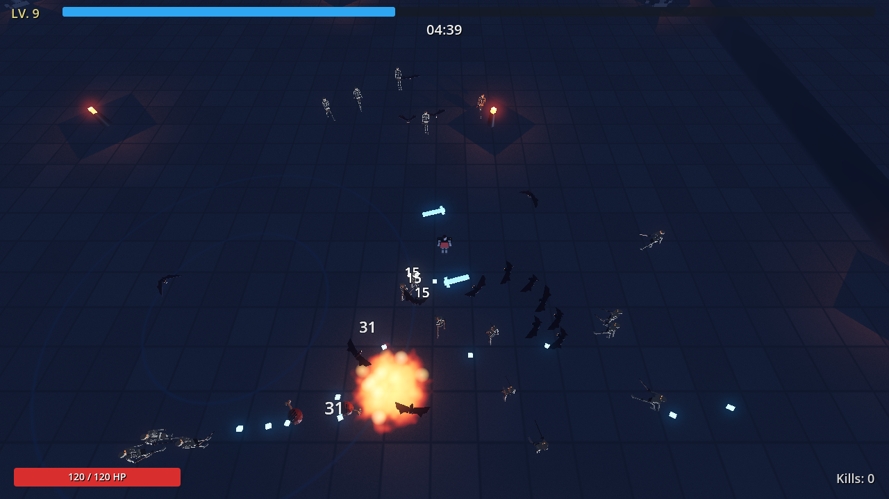
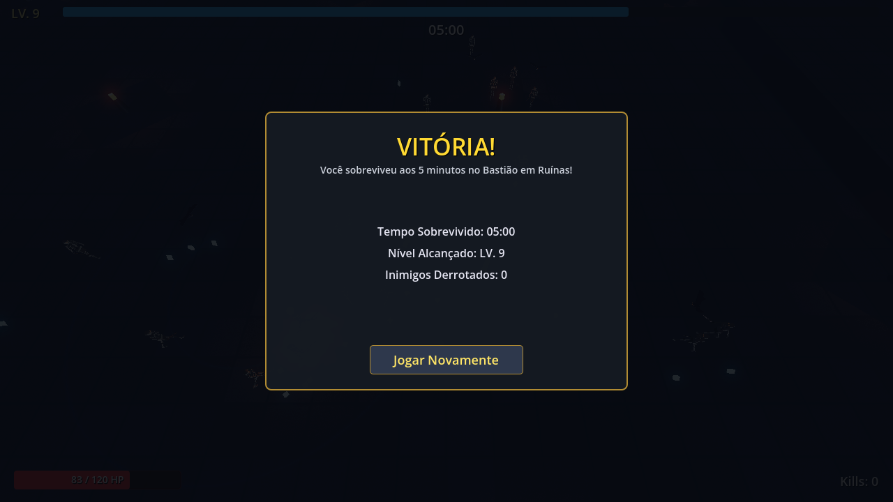

# Ashen Vanguard

> **3D Horde Survival / Bullet Heaven** construído em **Godot 4.7** e **Forward+**.  
> Inspirado na jogabilidade clássica e viciante de *Vampire Survivors*, com atmosfera de fantasia medieval sombria e modelos low-poly.

---

## 📸 Capturas de Tela

<div align="center">
  
  <p><em>Combate na arena do Pátio do Bastião em Ruínas com hordas de inimigos, armas ativas e efeitos de iluminação.</em></p>
  <br/>
  
  <p><em>Tela de Vitória aos 5:00 após derrotar o Mini-Chefe e sobreviver ao tempo limite da demonstração.</em></p>
</div>

---

## ⚔️ Funcionalidades do MVP (Loop de 5 Minutos)

- **Câmera Top-Down Direta:** Visão elevada sem oclusões ou obstáculos móveis de visão, garantindo 100% de leitura tática da arena.
- **Herói (O Cavaleiro):** Movimentação responsiva (WASD / Analógico), 120 HP, 2 de armadura base, raio de atração magnética de 2.5m e rotação dinâmica.
- **Arsenal Ativo Completo (4 Armas):**
  - ⚔️ **Espadas Espectrais (Orbit Blades):** Lâminas translúcidas girando ao redor do herói (níveis aumentam dano, quantidade e raio).
  - 🪄 **Dardos Mágicos (Magic Darts):** Disparos mágicos rápidos que teleguiam automaticamente o monstro mais próximo.
  - 🪓 **Machado de Batalha (Battle Axe):** Arremesso em parábola com impacto em área.
  - 🧪 **Frasco de Fogo (Fire Flask):** Cria poças de dano contínuo (DoT) no solo.
- **Itens Passivos de Atributo:**
  - 🧲 **Amuleto de Ímã:** +30% de raio de coleta de XP.
  - 🥾 **Botas Ágeis:** +10% de velocidade de movimento.
  - 🛡️ **Escudo de Ferro:** +1 de armadura e regeneração passiva de 1 HP a cada 5 segundos.
  - 🥩 **Carne Assada:** Drop raro restaurando 30 HP instantaneamente.
- **Timeline de Sobrevivência & Hordas:**
  - `00:00 - 01:00`: Esqueletos lentos aparecendo nas bordas da arena.
  - `01:00 - 02:30`: Densidade dobrada com Morcegos velozes voando baixo.
  - `03:00`: Surgimento do **Mini-Chefe (Cavaleiro Renegado Gigante)** com barra de vida no topo.
  - **Baú de Tesouro:** Drop garantido ao derrotar o chefe com upgrade automático.
  - `05:00`: Tela de **Vitória / Sobreviveu**.
- **Interface & Game Feel:**
  - Pausa imediata ao subir de nível com seleção de 3 cartas de upgrades.
  - Números de dano flutuantes (crítico e normal).
  - Barra de XP no topo, barra de vida, cronômetro de partida e contador de abates.

---

## 🕹️ Controles

| Tecla / Comando | Ação |
| :--- | :--- |
| **W, A, S, D** / **Setas** | Movimentação do Cavaleiro |
| **Mouse (Clique)** | Seleção de cartas na interface de Level Up |
| **Auto-Ataque** | Todas as armas operam automaticamente por ciclo de recarga (*cooldown*) |

---

## 🚀 Como Executar

### Pré-requisitos
- [Godot Engine 4.7+](https://godotengine.org) (versão padrão / Forward+)

### Execução no Editor
1. Abra o Godot e selecione **Importar**.
2. Aponte para a pasta raiz deste repositório (`project.godot`).
3. Pressione **F5** (ou o botão de Play no canto superior direito).

### Execução dos Testes Automatizados (Headless)
Você pode rodar a suíte completa de testes unitários diretamente via linha de comando:

```bash
godot --headless --path . --script res://tests/test_phase2_mvp.gd
```

---

## 📁 Estrutura do Projeto

```text
ashen-vanguard/
├── assets/
│   ├── models/        # Modelos 3D Low-Poly (.glb)
│   ├── shaders/       # Shaders de chão de pedra e poça de fogo (.gdshader)
│   └── audio/         # Efeitos sonoros e música
├── prints/            # Imagens e capturas de tela do jogo
├── scenes/
│   ├── characters/    # Cena do Cavaleiro e variantes
│   ├── enemies/       # Esqueleto, Morcego e Mini-Chefe
│   ├── environment/   # Pátio do Bastião e braseiros
│   ├── pickups/       # Cristais de XP, Carne Assada e Baú de Tesouro
│   ├── ui/            # HUD, tela de Level Up e Game Over / Vitória
│   └── weapons/       # Cenas de armas e projéteis
├── scripts/           # Scripts GDScript estaticamente tipados
├── tests/             # Suíte de testes headless para CI/CD
├── tools/             # Scripts de geração de modelos (Blender MCP)
├── AGENTS.md          # Diretrizes de desenvolvimento e engenharia
├── GDD.md             # Game Design Document
├── ROADMAP.md         # Cronograma de desenvolvimento por fases
└── project.godot      # Configuração principal da engine Godot
```

---

## 📄 Licença

Projeto desenvolvido para fins de entretenimento e estudo de mecânicas de *Horde Survival / Bullet Heaven*.
