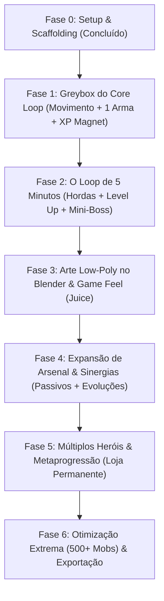

# ROADMAP — Ashen Vanguard (3D Horde Survival)

Este documento define o plano de entrega passo a passo do jogo, desde o núcleo de jogabilidade até a versão final de lançamento.

> **Diretriz de Execução (AGENTS.md):**  
> As Fases 1 e 2 devem ser executadas com o **código mais simples e concreto possível**, sem abstrações desnecessárias. Sistemas desacoplados e modulares só são autorizados a partir da Fase 4.

---

## Linha do Tempo Visual das Fases

---

## 🟢 Fase 0: Setup & Scaffolding (Concluída ✅)
* [x] Criação do repositório em `C:\Users\du-xb\Documents\games\ashen-vanguard`
* [x] Configuração inicial do `project.godot` (Godot 4.7, resolução 1280x720, inputs mapeados)
* [x] Criação do `GDD.md` (Game Design Document) com foco nos pilares mecânicos de *Vampire Survivors*
* [x] Criação do `AGENTS.md` (Diretrizes anti-overengineering e foco em precedentes)
* [x] Instalação de todas as 13 skills gamedev em `.agents/skills/`

---

## 🟢 Fase 1: O "Greybox" Jogável (MVP Mínimo) (Concluída ✅)
> **Objetivo de Experiência:** Sentir o Cavaleiro na mão com movimentação responsiva e fluida, câmera Top-Down limpa sem obstáculos visuais e a satisfação instantânea da primeira arma cortando inimigos e o ímã puxando cristais de XP.

* [x] **1.1 Arena de Teste & Câmera:**
  * Plano de chão com iluminação direcional e atmosfera sombria.
  * Câmera 3D Top-Down suave (`TopDownCamera`) seguindo o jogador com ângulo limpo e zero oclusão visual.
* [x] **1.2 O Cavaleiro (Controles & Física):**
  * `CharacterBody3D` (`Knight`) com aceleração responsiva (45.0), desaceleração suave (35.0) e rotação voltada para a direção do movimento.
  * Atributos fiéis ao GDD: 120 HP, 5.2 m/s, armadura 2, raio de ímã de 2.5m.
* [x] **1.3 Primeira Arma — Espadas Espectrais (*Orbit Blades*):**
  * 2 lâminas girando ao redor do herói em velocidade constante com material espectral ciano translúcido e emissivo.
  * Detecção de colisão via `Area3D` nas lâminas aplicando 15 de dano com cooldown de re-acerto.
* [x] **1.4 Inimigo Dummy & Morte:**
  * `DummySkeleton` que persegue o jogador em linha reta e colide.
  * Feedback visual de dano (*hit flash* momentâneo) e recuo (*knockback*).
  * Ao zerar HP, instancia gema de XP e é liberado da memória (`queue_free()`).
* [x] **1.5 Vácuo de XP (Ímã):**
  * `XPGem` detecta o `MagnetArea` do herói e acelera suavemente em direção a ele até ser absorvida.
  * Soma XP, atualiza barra no HUD e dispara evolução de nível.
* [x] **1.6 HUD Base & Validação:**
  * Barra de XP e indicador de nível no topo da tela.
  * Barra de vida e contador de abates (Kills).
  * Suite de testes headless automatizada (`tests/test_phase1.gd`) com 13/13 testes passando.

---

## 🟠 Fase 2: O Loop de Sobrevivência de 5 Minutos (Vertical Slice)
> **Objetivo de Experiência:** O loop viciante clássico: hordas cercando o jogador pela borda da tela, a barra de XP enchendo rapidamente, a pausa emocionante do Level Up com 3 escolhas de cartas e o pânico do primeiro Mini-Boss aos 3 minutos.

* **2.1 Spawner de Hordas por Tempo:**
  * Gerador baseado em timers que calcula posições fora da visão da câmera e instancia inimigos em círculos ao redor do herói.
  * Cronômetro de partida (00:00) visível no topo da tela.
* **2.2 Tipos de Inimigos:**
  * *Esqueleto Andarilho:* Lento, vida média, aglomera em grandes quantidades.
  * *Morcego Voraz:* Rápido, baixa vida, força o jogador a se esquivar ativamente.
* **2.3 Sistema de Level Up & Interface de Cartas:**
  * Pausa do jogo via `get_tree().paused = true`.
  * Janela modal com 3 cartas aleatórias geradas na hora:
    * *Upgrade da Espada Espectral* (+1 espada adicional na órbita ou +20% velocidade de rotação).
    * *Nova Arma:* **Mísseis Arcanos** (tiros rápidos retos no alvo mais próximo).
    * *Passivo:* +10% de velocidade de movimento ou +20% de raio de coleta.
* **2.4 O Mini-Boss (Minuto 03:00):**
  * Inimigo gigante com mais vida que nasce no minuto 3. Ao morrer, dropa um Baú de Tesouro com upgrade garantido.
* **2.5 HUD Completo:**
  * Barra de XP horizontal no topo da tela.
  * Indicador de Nível atual.
  * Barra de vida sobre o jogador ou no canto do HUD.
  * Contador de abates (Kills).

---

## 🔵 Fase 3: Arte Low-Poly no Blender & Game Feel ("Juice")
> **Objetivo de Experiência:** Tirar o jogo do visual cinza provisório e torná-lo visualmente imersivo, sombrio e muito crocante/satisfatório em cada acerto.

* **3.1 Modelagem e Exportação no Blender 5.2 (via MCP):**
  * Modelo do Cavaleiro com proporções humanas anatômicas normais em Low-Poly (armadura de placas, elmo e capa).
  * Modelos de monstros: Esqueleto com espada e Morcego com asas angulares.
  * Modelo dos Cristais de XP brilhantes (octaedro facetado) e baú de tesouro.
  * Kit de cenário do **Pátio do Bastião em Ruínas** (lajes de pedra, colunas góticas nas bordas e tochas acesas).
* **3.2 Iluminação e Atmosfera no Godot 4:**
  * `WorldEnvironment` configurado com luz ambiente fria, névoa volumétrica suave no chão e luz de tochas com sombras projetadas.
* **3.3 Game Feel (Impacto & Feedback):**
  * **Números de Dano Flutuantes:** Números saltam na cabeça dos monstros a cada golpe.
  * **Hit-Flash:** Flash branco momentâneo na malha do monstro ao receber dano.
  * **Screen Shake:** Tremor suave de câmera em golpes pesados ou ao tomar dano.
  * **Efeitos Sonoros:** Som de corte metálico, sino/estalo ao coletar gemas e fanfarra ao subir de nível.

---

## 🟣 Fase 4: Expansão de Arsenal & Sinergias (Profundidade Tática)
> **Portão de Complexidade (AGENTS.md):** Autorizada a refatoração para um gerenciador modular de armas e passivos extensíveis.

* **4.1 Novas Armas Ativas:**
  * *Machado de Batalha:* Lançado em arco parabólico com alta área de dano ao cair.
  * *Frasco de Fogo:* Cria zonas temporárias de fogo no solo (dano por segundo).
  * *Descarga Elétrica:* Trovões verticais que atingem inimigos aleatórios.
* **4.2 Passivos de Atributos:**
  * Amuleto de Ímã (+raio de coleta).
  * Escudo de Ferro (+armadura e regeneração de HP).
  * Coração de Titã (+vida máxima).
* **4.3 Evolução de Armas (Weapon Evolution):**
  * Mecânica clássica de *Vampire Survivors*: Arma no nível máximo + Passivo específico correspondente no baú = Arma Evoluída lendária (ex: Espadas Espectrais -> Lâminas do Juízo Final com rastro de luz contínuo).

---

## 🔴 Fase 5: Múltiplos Heróis & Metaprogressão (Rejogabilidade)
> **Portão de Complexidade (AGENTS.md):** Autorizada a criação do sistema de persistência de save e seleção desacoplada de personagens.

* **5.1 Novos Personagens Jogáveis:**
  * *O Mago Arcanista:* Começa com Mísseis Arcanos, maior alcance, menor vida base.
  * *O Patrulheiro:* Começa com Flechas Perfurantes, maior velocidade base.
  * *O Paladino:* Começa com Fogo Sagrado, alta armadura e cura passiva.
* **5.2 Economia de Ouro:**
  * Inimigos e baús dropam moedas de ouro que persistem entre as partidas.
* **5.3 Loja de Metaprogressão:**
  * Menu permanente onde o jogador gasta o ouro ganho para comprar melhorias eternas (+Dano Geral, +Velocidade, +Recuperação, +Sorte).

---

## ⚫ Fase 6: Otimização Extrema (500+ Mobs) & Distribuição
> **Objetivo:** O jogo rodar a 60 FPS cravados no ápice da loucura da horda e estar pronto para distribuição.

* **6.1 Otimização de Performance:**
  * *Object Pooling:* Reutilização de nós de projéteis, números de dano e gemas para zerar coletas de lixo do motor (*Garbage Collection*).
  * Otimização de nós de colisão e desativação de processamento de inimigos fora do campo de visão.
* **6.2 Menus e Polimento Final:**
  * Menu Principal com seleção de herói e música tema.
  * Menu de Pausa funcional com lista de armas e passivos atuais.
  * Configurações de volume (Master, SFX, Música) e resolução de tela.
* **6.3 Exportação Windows:**
  * Compilação e empacotamento do executável final (`AshenVanguard.exe`) pronto para jogar.
